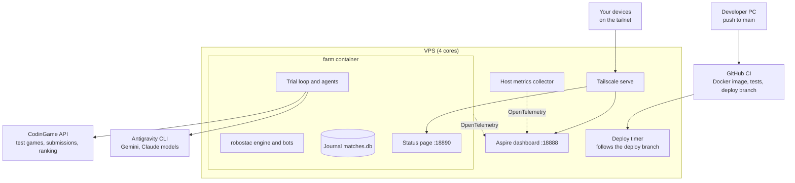
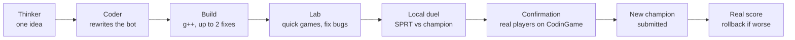

# CodinGame Agent — Mad Pod Racing farm

> **Status**: in production · **Last updated**: 2026-11-19

An autonomous loop that keeps improving a bot for the CodinGame multiplayer game
[Mad Pod Racing](https://www.codingame.com/multiplayer/bot-programming/mad-pod-racing).
AI agents propose and write changes, an existing game engine plays the candidate against the
current champion, a statistical test decides, and real CodinGame games confirm before anything
is submitted to the leaderboard.

Core principle: **an AI never decides whether a bot is better.** It proposes; a calculation
(sequential probability ratio test, then real games) decides.

Since the farm started, the account went from Silver (around 89,700th worldwide) to the Legend
league, around 100th out of about 236,000 players (best: 98th, on 2026-11-19).

## Architecture



Everything runs in Docker Compose on a single VPS:

| Container | Role |
| :--- | :--- |
| `farm` | The trial loop, the local game engine, the journal, the status page and the hourly ranking record |
| `dashboard` | Standalone .NET Aspire dashboard: logs, traces and `farm.*` metrics |
| `vps` | OpenTelemetry Collector (`hostmetrics`): CPU, load, memory and disks of the machine |

Nothing listens on the Internet. The status page and the dashboard only listen on the VPS and are
published on a private [Tailscale](https://tailscale.com) network with `tailscale serve`, so they
open from the owner's devices only.

## One trial



1. **Thinker** (Antigravity, Gemini Flash High): reads the official rules, the engine notes, a
   strategy sheet, the champion's source and the history of past trials, and writes one idea in
   a short note.
2. **Coder** (Antigravity, Gemini Flash Medium): applies the note to the C++ bot, in one pass.
3. **Build**: `g++ -std=c++20`; compile errors go back to the coder up to twice.
4. **Lab**: the farm plays 40 quick games of the candidate against the champion. A fault or a
   win rate below 45 % goes back to the coder as `LAB.md`, so it can fix a bug in its
   implementation before the expensive judge (at most twice). The agent still runs no command:
   the farm plays the games.
5. **Local duel**: candidate against champion with the
   [robostac referee](https://github.com/robostac/coders-strike-back-referee), each map played
   from both seats, in parallel, until Wald's SPRT reaches a verdict (H0: 0 Elo, H1: 40 Elo,
   alpha = beta = 0.05). A duel that reaches its cap while the candidate leads is extended once.
6. **Confirmation on CodinGame**: the real engine, compiler and time limits. Candidate and
   champion each play 4 games against 6 real players ranked up to 60 places above us, on the
   exact same maps. The candidate is rejected if it loses more of these games than the champion
   does. Opponents are picked by a fixed rule, not by an AI.
7. **Promotion**: the candidate becomes champion and is submitted to the leaderboard.
8. **Real score**: once the submission is fully ranked, its score is stored with the champion.
   If it is lower than the previous champion's by more than 1 point, the new champion is
   withdrawn and the previous one is resubmitted. The agents see real scores and withdrawals in
   their history.

### Loss analysis

The thinker is told why the champion loses, not only how often. Every bot writes one trace line
per turn to standard error (`T` and the 24 integers it read). CodinGame keeps our standard error
in the logs of test games and ranked games, so the farm sees the position and speed of the 4 pods
at every turn, plus every pod's command from the referee's lines; locally it sees the same through
the engine relay.

- **Collisions** are found without simulating the race: the next state of a pod that hits nothing
  follows from its state and command (rotation, thrust, rounding, friction). A pod far from that
  prediction collided. On real games the gap is clean: within a few units, or hundreds.
- **Measures** per game and per team: collisions suffered by the runner, collisions between the
  team's own pods, the runner's turns per checkpoint on collision-free stretches, the final gap.
- **One cause per lost game**, by a fixed rule in this order: fault, blocking battle lost, slower
  runner, narrow finish, other. Thresholds live in `pipeline.json` (`analyse`).
- The thinker and the fresh look get `LOSSES.md` (causes, averages of won and lost games, the
  clearest example of each cause). The thinker names the cause it targets; the history shows, for
  each trial, the duel's measures candidate against champion; the lab tells the coder the same,
  and sends a version without the trace line back.
- The farm reads up to 30 new ranked games of the champion every hour; the status page shows the
  causes of its real losses.

A trial ends early on an agent failure, a build failure, a fault (crash, timeout or invalid move)
or a rejection. After 6 trials without a new champion, a **fresh look** agent (Claude Opus, then
Gemini High) reviews the whole history and writes a new direction for the thinker.

### Models and fallback

Each role uses the strongest model of its chain first (`modele`, then `secours`). A model that
hits its quota or becomes unavailable is set aside for `agents.blocage_minutes`, recorded on disk
so it survives restarts, and the call moves to the next model. An unfinished answer (cut at the
output token limit or stopped by the time limit) retries with the next model without blocking the
first one. Antigravity's exit code proves nothing: the farm reads its JSON status and checks what
was actually produced.

## Repository layout

```
src/CodinGame.Core/             config, journal, CodinGame API client, engine relay, duel, SPRT,
                                agents, trial, farm loop, status page
src/CodinGame.Cli/              the `farm` command
src/CodinGame.ServiceDefaults/  OpenTelemetry export to the Aspire dashboard
src/CodinGame.AppHost/          local run with the Aspire dashboard
tests/CodinGame.Tests/          unit tests; real games run inside the Docker image
pipelines/mad-pod-racing/       configuration, agent prompts, rules notes, starting bots
deploy/                         Docker Compose, container entrypoint, deploy timer
.Agent/                         design documents (PIPELINE_SPEC.md is the reference)
```

Adding another game means adding a folder under `pipelines/` with its configuration, prompts,
starting bot and a `cg-brutaltester`-compatible engine command. No farm code to write.

## Commands

```
farm servir                       continuous loop (the container's default), status page, ranking record
farm essai [pipeline]             a single trial
farm verifier [pipeline]          prerequisites check (token present, API, engine, Antigravity, models)
farm bilan [pipeline]             journal summary
farm duel <a> <b> [n]             local duel between two bot sources
farm rejuger <trial>              re-judge the candidate of a past trial
farm juger <source> <idea> [note] judge a bot written outside the farm, same steps and thresholds
farm banc                         measure the champion against the local bench of outside bots
farm page <file.html>             write the status page to a file
```

Development:

```
dotnet build CodinGame.sln
dotnet test --solution CodinGame.sln
dotnet run --project src/CodinGame.AppHost
```

## Configuration

`pipelines/<game>/pipeline.json` is the seed shipped in the image. The live copy under the data
folder on the VPS overrides it, is read again at every trial, and can be edited without
rebuilding. Unknown keys are rejected with the faulty field named. Main sections:

| Section | Holds |
| :--- | :--- |
| `agents` | Tool, model, fallback chain and time limit of each role |
| `arene` | Engine command, parallelism, time limits, SPRT parameters |
| `api` | Confirmation (games per opponent, number of real players, rank span), automatic submission, ranking record interval, rollback threshold |
| `laboratoire` | Coder's lab: quick games, revision threshold, maximum revisions |
| `analyse` | Loss analysis: collision threshold, cause thresholds, ranked games read per hour |
| `boucle` | Trials per day, rejections before a fresh look, retries, pauses |
| `contexte` | How much history the agents see |
| `banc` | Optional local bench of outside bots (empty by default: it no longer separated our versions) |

## Data

`matches.db` (SQLite) is the source of truth: every trial with its idea, note, verdict and tokens
per role, every local and CodinGame game, every champion, the source of every bot ever tried,
the fresh-look directions, the hourly ranking and the measures of every analysed game. Results
are never taken from anywhere else.

## Security

- The CodinGame token is never printed, pasted or committed. On the VPS it is a root-owned,
  read-only file that neither the agents nor the bots can read.
- Agents run as a dedicated `agent` user, in a folder holding only what they must read and the
  one file they may write; command execution and URL fetching are denied.
- Every bot, ours or other players', runs as a dedicated `bot` user without access to secrets.
- No secret lives in the image or the repository.
- Code from elsewhere only runs with the owner's explicit approval.

## Deployment

A push to `main` triggers the CI, which builds the Docker image (compiling and running the tests,
real engine games included) and, if everything passes, moves the `deploy` branch. A systemd timer
on the VPS checks that branch every 2 minutes, rebuilds and restarts the farm. A push therefore
interrupts the trial in progress. `git reset --hard` is never used, in code or in deployment.

## Third-party software

- Game engine: [robostac/coders-strike-back-referee](https://github.com/robostac/coders-strike-back-referee)
  (MIT), pinned to a commit and built in the image.
- Optional outside bots for the local bench: published Legend bots (GPL-3) and
  [inoryy/csb-ai-starter](https://github.com/inoryy/csb-ai-starter) (MIT), pinned and built in the
  image, never copied into this repository.
- Antigravity CLI for the agents, .NET 10, SQLite, .NET Aspire 13.6,
  OpenTelemetry Collector Contrib.

## Roadmap

- More measures for the agents (real win rate by rank band, simulations per turn, judge
  resolution) and automatic alerts.
- Decisions to approve from the status page (judge settings, larger work items).
- A "work item" mode letting a large change mature over several trials before being judged.
- A small population of scored variants instead of a single champion, to accumulate small gains.
